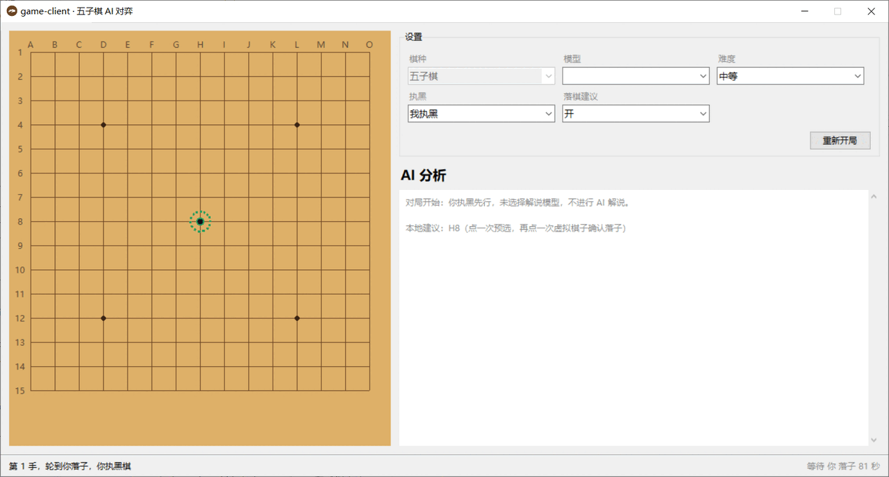

<p align="center">
  
</p>

<h1 align="center">game-client · 五子棋 AI 对弈学习</h1>

<p align="center">
  Windows 桌面五子棋 · 本地引擎走棋 · 多家 LLM 流式解说
</p>



## 功能特性

- **本地 AI 对弈**：Minimax + Alpha-Beta 剪枝，四档难度（深度 2~5），走棋不依赖 LLM
- **多家模型解说**：DeepSeek / Kimi / GLM / 豆包，统一 OpenAI 兼容接口，流式输出
- **本地落子建议**：引擎按当前难度 +1 层搜索，不依赖模型，也不会建议已占用的位置
- **两次点击落子**：第一次预选、可改选，再次点击虚拟棋子确认；Esc / 右键取消
- **无 Key 也能玩**：不配置任何 API Key 时，对局、难度与落子建议全部可用
- **对局持久化**：SQLite 保存对局、落子与解说，日志按天轮转
- **失败降级**：LLM 网络/鉴权/限流异常时仅显示「解说不可用」，不影响对局

## 系统要求

- Windows 10 / 11
- Python 3.12
- [uv](https://docs.astral.sh/uv/)（推荐）或 pip

## 快速开始

```powershell
# 0. 克隆仓库
git clone git@github.com:Solariade/game-client.git
cd game-client

# 1. 安装依赖
uv sync

# 2. 配置模型 Key（可选；不填也能下棋，只是没有 AI 解说）
copy .env.example .env

# 3. 启动
uv run python -m app
```

## 配置模型（可选）

编辑 `.env`，填入任意一家或多家模型的 Key：

| 模型 | API Key 变量 | 默认模型 | Base URL |
|---|---|---|---|
| DeepSeek | `DEEPSEEK_API_KEY` | `deepseek-chat` | `https://api.deepseek.com` |
| Kimi | `KIMI_API_KEY` | `moonshot-v1-8k` | `https://api.moonshot.cn/v1` |
| GLM | `GLM_API_KEY` | `glm-4-flash` | `https://open.bigmodel.cn/api/paas/v4` |
| 豆包 | `DOUBAO_API_KEY` | 接入点 ID（`ep-xxxx`） | `https://ark.cn-beijing.volces.com/api/v3` |

- `DEFAULT_LLM`：默认解说模型，可选 `deepseek` / `kimi` / `glm` / `doubao`；
- 豆包的 `DOUBAO_MODEL` 需填写方舟接入点 ID；
- Key 只保存在本机 `.env` 中，已被 `.gitignore` 忽略，不会上传或打包外泄。

更多说明见 [LLM 接入说明](docs/llm-integration.md)。

## 使用

- 你执黑先行，点击棋盘交叉点落子；右侧可选择解说模型、难度、执黑方与「落棋建议」开关；
- AI 落子后出现的绿色虚线光环是本地引擎的建议落点：第一次点击预选，再次点击虚拟棋子确认；
- 专家模式思考约 8~15 秒；每步会调用一次 LLM，一局约 20~40 次请求；
- 对局数据保存在 `runtime/data/gomoku.db`，日志位于 `runtime/log/app.log`；
- 完整操作说明见 [使用说明](docs/使用说明.txt)。

## 项目结构

```
app/
├── core/        领域层：棋盘、规则、棋种抽象（纯标准库）
├── ai/          引擎层：Minimax + Alpha-Beta、评估、走法排序
├── llm/         模型接入：OpenAI 兼容客户端、提示词、注册表、降级
├── services/    编排层：轮次状态机、解说流水线
├── ui/          Tkinter 界面：棋盘、分析面板、设置与状态栏
├── db/          SQLite 持久化：建表即用
└── common/      路径、日志、线程、错误等横切工具
```

依赖方向：`ui → services → (core, ai, llm, db)`，`core` 不依赖上层。详见 [架构说明](docs/architecture.md)。

## 开发与测试

```powershell
uv run pytest                 # 测试（116 项）
uv run pytest --cov=app       # 覆盖率
uv run ruff check .           # lint
uv run ruff format --check .  # 格式检查
uv run mypy app               # 类型检查
```

提交前请安装并运行 pre-commit：

```powershell
uv run pre-commit install
uv run pre-commit run --all-files
```

开发规范、代码约定与提交信息格式见 [开发规范](docs/development.md)。

## 打包

```powershell
uv run python build.py
```

默认目录模式，自动清理旧产物，输出 `dist/game-client-v<version>/`。版本号取自 `pyproject.toml` 并写入 exe 版本信息；产物中的 `.env` 由 `.env.example` 生成，不含真实 Key。

```
dist/game-client-v1.0.0/
├── game-client.exe
├── assets/               # 图标与图片资源
├── _internal/            # PyInstaller 运行时
├── .env / .env.example
├── README.md / LICENSE
├── VERSION.txt
└── 使用说明.txt
```

`runtime/` 由程序首次运行自动创建。分发时拷贝整个版本目录即可。

## 文档

- [文档索引](docs/README.md)
- [架构说明](docs/architecture.md)
- [开发规范](docs/development.md)
- [LLM 接入说明](docs/llm-integration.md)
- [归档：完整开发方案](docs/archive/development-plan.md)
- [更新日志](CHANGELOG.md)

## 贡献

欢迎提交 Issue 与 Pull Request。开始前请阅读 [贡献指南](CONTRIBUTING.md) 与
[开发规范](docs/development.md)，并确保 `ruff`、`mypy`、`pytest` 全部通过。

安全漏洞请按 [安全策略](SECURITY.md) 私下报告，不要公开提交 Issue。

## License

[MIT](LICENSE) © 2026 [Solariade](https://github.com/Solariade)
